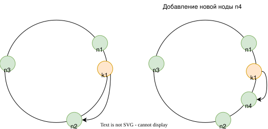

# Хэширование в распределенных системах

Когда все данные помещаются в памяти одного сервиса, то никаких проблем с [хэштаблицами](../data_structures/hashtable.md) нет.
Но если данные распределены между несколькими шардами, то возникает проблема определения шарда, отвечающего за запрашиваемые данные, и проблема перебалансировки данных при добавлении / удалении нод.

Существуют такие решения:
- mod N - остаток от деления [хэш-функции](./hash_function.md) от ключа на общее количество нод.
- key range - каждой ноде выделяется интервал ключей, за которые она отвечает.
- hash partition - все пространство хэшей заранее дробится на заданное достаточно большое количество партиций.
- consistent hashing - пространство хэшей представляется в виде кольца, которое разбивается на сектора, присваиваемые конкретным нодам.
- rendezvous hashing - для каждой ноды вычисляется хэш на основе ключа и идентификатора ноды, и выбирается нода с максимальным значением хэша.
- ...

## Mod N
Нода определяется вычислением остатка от деления хэша от ключа на количество нод.
Таким же образом вычисляется бакет в [хэш-таблицах](../data_structures/hashtable.md) с закрытой адресацией.
```
node_index = hash(key) % N
```

У этого способа есть значительный недостаток.
При добавлении новых нод или исключении старых, количество нод меняется и результат вычисления по формуле для ранее существовавших ключей изменяется.
Из-за этого приходится передвигать между нодами огромное количество данных.

В идеале хотелось бы, чтобы при добавлении новой ноды, единственным движением ключей, был бы перенос данных на эту новую ноду.


## Dictionary node
### Key range
Каждой ноде заранее присваивается диапазон ключей.
Например:
```
node1: [-Inf, K1)
node2: [K1, K2)
node3: [K2, +Inf]
```

Данные о диапазоне ключей хранятся на dictionary ноде.
Клиенты кэшируют справочник локально.

При этом хэширование может вообще не использоваться.
При таком подходе удобно делать запросы по диапазону ключей, так как легко вычислить на какие ноды они будут приходиться. 
Для небольших диапазонов чаще всего все ключи будут принадлежать одной ноде.

Еще одно преимущество такого подхода - если какие-то ключи являются "горячими", то их можно выделить на отдельную высокопроизводительную ноду.

### Hash partition
Все пространство хэшей заранее дробится на заданное достаточно большое количество партиций.
Для количества партиций обычно выбирают простое число, которое на порядок больше предполагаемого количества нод.
Затем партиции распределяются между нодами.

При добавлении новой ноды или выводе существующей происходит перераспределение партиций между нодами.

Такой подход используется в [Hazelcast](../external_lib/hazelcast.md).

## Consistent Hashing
В consistent hashing все пространство хэшей представляется в виде кольца.
Затем на это кольцо распределяются ноды (для этого так же может использоваться хэш-функция от имени сервера или ip).
Принадлежность ключа к ноде определяется так: высчитывается хэш от ключа, и затем по часовой стрелке определяется первая встречная нода.



При добавлении новой ноды она откусывает себе сектор хэш-кольца.

При малом количестве нод они могут распределяться по кольцу хэшей неравномерно.
Из-за этого может быть перекос в объеме ключей, принадлежащих той или иной ноде.
Также это может приводить к еще бОльшему перекосу при выводе ноды: тогда все ее пространство ключей получает следующая за ней по часовой стрелке.
Чтобы избавиться от этого недостатка, каждую ноду дробят на некоторое количество виртуальных нод (vNode).
Например, около 100.
И распределяют по хэш-кольцу виртуальные ноды.

Недостаток vNode - это дополнительный объем метаданных, который приходится хранить и распространять между нодами системы и клиентами (если на клиенте есть кэширование метаданных).
Если назначить много vNode, то объем метаданных может быть значительным.
А если назначить мало vNode, то будет недостаточно равномерное распределение ключей по нодам.

Преимущество vNode - можно назначить более производительным серверам бОльшее значение vNode. 
Таким образом они получат больше нагрузки, чем остальные сервера.

Алгоритм consistent hashing гарантирует, что при равномерном распределении хэшей ключей по пространству хэшей, при добавлении новой ноды потребуется переместить не более n/m ключей, где n - общее количество ключей, а m - актуальное количество нод.

Поиск ноды, в которой находится ключ, для consistent hashing имеет [алгоритмическую сложность](./complexity.md) `O(log(n))`.

## Rendezvous Hashing
todo


---
## Реальные применения

### Kafka
В [Kafka](../tools/kafka.md) данные разделяются по партициям, а партиции распределяются по брокерам.
Автоматического перераспределения партиций по брокерам при добавлении новых брокеров или выводе старых - нет.
Для распределения сначала составляется план миграции (например с помощью [kafka-kit](https://github.com/DataDog/kafka-kit)), а затем он накатывается на кластер.

План миграции вычисляется с учетом топологии кластера - ЦОДов и стоек.
Для составления оптимального плана миграции используются жадные алгоритмы и динамическое программирование.

### Cassandra
В [Cassandra](../database/cassandra.md) используется подход consistent hashing.
Каждой ноде по умолчанию присваивается 256 vNode.
При желании можно уменьшить количество vNode в зависимости от возможностей сервера.

### Hazelcast
В [Hazelcast](../external_lib/hazelcast.md) используется подход с hash partition.
При вводе новой ноды, пересчитывается количество партиций, приходящихся на одну ноду.

По умолчанию всего 271 партиция.
Для кластера из 3 нод каждая нода владеет ~90 партициями.
При добавлении 4 ноды каждая нода будет владеть ~67 партициями.
Для каждой из существующих 3 нод выбирается 23 партиции, которые должны будут переехать на ноду №4.
Выбор осуществляется случайным детерменированным алгоритмом.

После этого начинается миграция данных.
Сначала мигрируют бэкап-реплики данных, потом основная реплика.
Когда все реплики перемещены, переключается адресация, и устаревшие реплики удаляются с своих прошлых нод.

---
## К изучению

- [X] Книга Алекса Сюй "System Design Interview", глава 5
- [ ] [Обзор разных способов распределения хэшей](https://medium.com/@dgryski/consistent-hashing-algorithmic-tradeoffs-ef6b8e2fcae8)
- [X] [Встреча книжного клуба Между Скобок по Consistent Hashing](https://youtu.be/kiVaBDnZ89Y)
- [ ] [Consistent hashing white paper](https://www.cs.princeton.edu/courses/archive/fall09/cos518/papers/chash.pdf)
