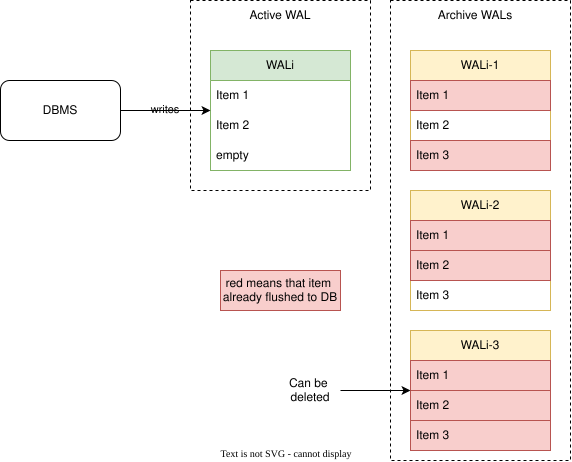

# Write-ahead Log

__Write-ahead log__ (__WAL__), он же __Commit Log__ - это append-only структура данных, хранящаяся на диске, предназначенная для восстановления после сбоев.
WAL - это первое место куда записываются изменения над данными, хранящимися в БД.
Только после того, как данные попали в него, операция может продолжить выполнение.

WAL нужен для того, чтобы в случае сбоя, можно было перепрогнать операции, которые могли быть выполнены не полностью.

Также WAL иногда используют для [репликации](./replication.md).
WAL реплицируется на реплику, где операции выполняются независимо.
Так как в исходных запросах могут использоваться функции, которые вычисляются на сервере БД (`date()`, `random()`, `uuid()` и т.д.), то зачастую они выполняются до записи в WAL.

WAL используются и в реляционных БД, например [PostgreSQL](./postgresql.md) или MySQL, и в [NoSQL](./nosql.md), например в [Cassandra](./cassandra.md).

Для того, чтобы WAL не разрастался бесконечно, он разбивается на сегменты фиксированного размера.
Запись ведется только в активный сегмент.
Когда активный сегмент достигает предельного размера, запись начинается в следующий сегмент, который становится активным.
Архивные сегменты могут быть удалены, когда операции, записанные в них, применились в БД.

---
## К изучению

- [X] [Статья на Вики](https://en.wikipedia.org/wiki/Write-ahead_logging)
- [X] Книга Алекса Петрова "Распределенные данные", глава 5
